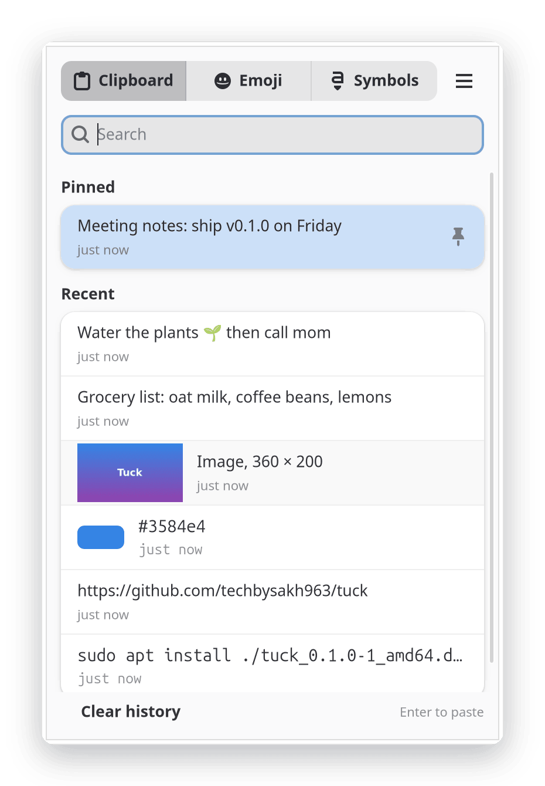
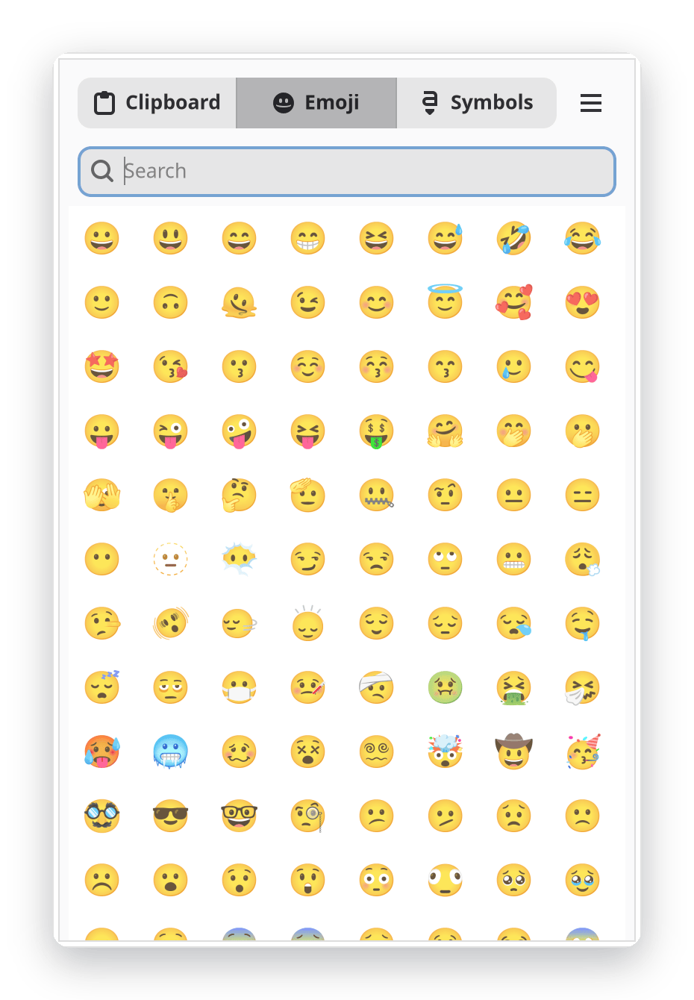
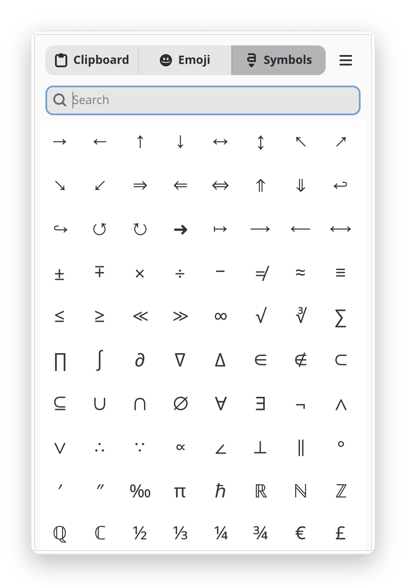

<p align="center">
  
</p>

<h1 align="center">Tuck</h1>

<p align="center">
  Clipboard history, emoji and symbols for GNOME, one keystroke away.
</p>

<p align="center">
  <a href="https://github.com/techbysakh963/tuck/actions/workflows/ci.yml"></a>
  <a href="LICENSE"></a>
  
  
</p>

<p align="center">
  <picture>
    <source media="(prefers-color-scheme: dark)" srcset="docs/screenshots/clipboard-dark.png">
    
  </picture>
  <picture>
    <source media="(prefers-color-scheme: dark)" srcset="docs/screenshots/emoji-dark.png">
    
  </picture>
  <picture>
    <source media="(prefers-color-scheme: dark)" srcset="docs/screenshots/symbols-dark.png">
    
  </picture>
</p>

Tuck keeps a searchable history of what you copy and pastes it back with one
click. Press **Super+V** (or **Ctrl+Alt+V**), pick an item, and it lands in the
app you were using, terminals included. The same popup has emoji and symbol
pickers.

It is built with GTK 4 and libadwaita, so it looks like the rest of GNOME and
follows your theme, accent colour and fonts. It stays out of the way: no
polling while idle, no web view, and about 60 MB of memory.

## Features

- **Clipboard history** for text, rich text, images and copied files, with
  search and pinned items.
- **Emoji and symbol pickers** in the same popup. Inserting one never lands in
  your history, and your previous clipboard item is put back afterwards.
- **Pastes where you were working**, on Wayland and X11. In terminals it uses
  the terminal shortcut for you.
- **Private by default.** Copies from password managers that mark them as
  sensitive are skipped, and you can add your own exclusion patterns. History
  is stored readable only by you.
- **Light on resources.** Nothing runs while the clipboard is idle.
- **Optional top-bar icon** with pause, preferences and quit.

## Built with

| | |
| --- | --- |
| Language | [Rust](https://www.rust-lang.org/) (2021 edition, 1.92 or newer) |
| Interface | [GTK 4](https://www.gtk.org/) and [libadwaita](https://gnome.pages.gitlab.gnome.org/libadwaita/) through `gtk4-rs` |
| Clipboard capture | X11 (XFixes) and the Wayland data-control protocols |
| Pasting | `/dev/uinput` on Wayland, XTest on X11 |
| Terminal detection | AT-SPI over D-Bus (`zbus`) |
| Tray icon | StatusNotifierItem (`ksni`) |

## Install

### From a package

Download the latest `.deb` (Debian, Ubuntu) from the
[Releases](https://github.com/techbysakh963/tuck/releases) page and install it:

```sh
sudo apt install ./tuck_0.1.0-1_amd64.deb
```

Compare the file with `SHA256SUMS` from the same release if you like:

```sh
sha256sum -c SHA256SUMS --ignore-missing
```

Then open **Tuck** from the app grid. An `.rpm` for Fedora is built by the
release workflow and will appear on the Releases page as it is published.

### From source

You need Rust 1.92 or newer, GTK 4.14 or newer and libadwaita 1.5 or newer.

On Ubuntu 24.04 or Debian:

```sh
sudo apt-get install libgtk-4-dev libadwaita-1-dev libxkbcommon-dev pkg-config
cargo build --release
cargo run --release
```

A plain build does not install the `uinput` udev rule or the desktop entry and
does not put `tuck` on your `PATH`. Pasting on Wayland needs that rule, so
prefer the package, or copy the files in `data/` into place yourself.

## Getting started

The first time you open Tuck it asks how you want to open it:

- **Super+V** replaces GNOME's notification-list shortcut.
- **Ctrl+Alt+V** takes nothing away from you. It is the default if you decline.

You can change this later in Preferences. Tuck also starts at login; you can
turn that off in Preferences too.

Copy things as you normally do, then press your shortcut and pick one.

### Keys

| Key | Action |
| --- | --- |
| Super+V or Ctrl+Alt+V | Open or close the popup |
| Up, Down | Move through items |
| Enter | Paste the selected item |
| Shift+Enter | Paste with the terminal shortcut (Ctrl+Shift+V) |
| Ctrl+P | Pin or unpin the selected item |
| Delete | Remove the selected item |
| Ctrl+Tab, Alt+1 to Alt+3 | Switch between Clipboard, Emoji and Symbols |
| Esc | Close the popup |

Just start typing to search. The menu (the three dots) has Preferences, Pause
recording, Clear history, About and Quit.

The top-bar icon needs the AppIndicator extension. Ubuntu enables it by
default; on other GNOME systems install `gnome-shell-extension-appindicator`.

## Privacy

- Copies that carry the sensitive-content hint (`x-kde-passwordManagerHint`)
  set by supporting password managers are not recorded. Applications that do
  not set the hint cannot be detected, so their copies are recorded like any
  other.
- In Preferences you can add exclusion patterns (regular expressions). A copy
  that matches one is skipped.
- Recording can be paused from the menu or from Preferences.
- History lives in `~/.local/share/tuck` and settings in `~/.config/tuck`,
  with directories at mode 0700 and files at 0600. The log at
  `~/.local/share/tuck/logs/tuck.log` never contains clipboard content.
- **Clear history** removes everything except pinned items. To remove
  everything, quit Tuck first (it saves again when it exits) and delete
  `~/.local/share/tuck`.

## Troubleshooting

### Paste does nothing on Wayland

Tuck types the paste shortcut through `/dev/uinput`. Check that your user can
use it:

```sh
getfacl /dev/uinput
```

You should see `user:<your name>:rw-`. If you do not, log out and back in so
the udev rule from the package applies to your session. If it is still
missing, make sure `/usr/lib/udev/rules.d/70-tuck-uinput.rules` exists, then
reload the rules:

```sh
sudo udevadm control --reload-rules
sudo udevadm trigger --action=change --subsystem-match=misc --sysname-match=uinput
```

### The tray icon does not show

Your desktop needs a StatusNotifier host. On GNOME that is the AppIndicator
extension. Enable it with `gnome-extensions enable ubuntu-appindicators@ubuntu.com`
(Ubuntu) or install `gnome-shell-extension-appindicator`. Tuck's icon appears
by itself as soon as the host is running.

## Known limitations

- **Flatpak is not supported.** Tuck needs `/dev/uinput` to paste on Wayland,
  the X11 clipboard bridge, and the accessibility bus to detect terminals.
  None of them are available inside the sandbox.
- GNOME on Wayland is the tested setup. Backends for KDE and wlroots-based
  compositors exist but have not been tried on a real session.
- In terminals that do not expose accessibility information, Enter pastes with
  Ctrl+V. Use Shift+Enter there.
- On Wayland the compositor decides where the popup appears.
- The paste shortcut is typed for the first keyboard layout in your list. With
  several layouts the key can be wrong while another one is active. Fixing that
  needs GTK 4.18, which Tuck does not require yet.
- The interface is English only.

## Uninstall

Removing the package does not touch your GNOME settings or your home
directory, so do these in order:

1. Open Preferences, then Keyboard, and choose **Reset shortcut** so no custom
   shortcut is left behind.
2. Turn off **Start at login** in Preferences, or delete
   `~/.config/autostart/io.github.techbysakh963.Tuck.desktop`.
3. Quit Tuck from the popup menu.
4. Remove the package with your package manager.
5. Optionally delete your data:

   ```sh
   rm -r ~/.local/share/tuck ~/.config/tuck
   ```

## Security

On Wayland, Tuck types the paste shortcut through a virtual keyboard
(`/dev/uinput`). The package installs a udev rule that gives the logged-in
desktop user access to that device, which means any program running as you can
also inject keystrokes. If you do not accept that, delete
`/usr/lib/udev/rules.d/70-tuck-uinput.rules`. On X11 Tuck uses XTest and does
not need the device.

To report a vulnerability, see [SECURITY.md](SECURITY.md).

## Contributing

Bug reports and pull requests are welcome. See
[CONTRIBUTING.md](CONTRIBUTING.md) for how to build, the checks to run and the
commit style.

## License

GPL-3.0-or-later. See [LICENSE](LICENSE).
